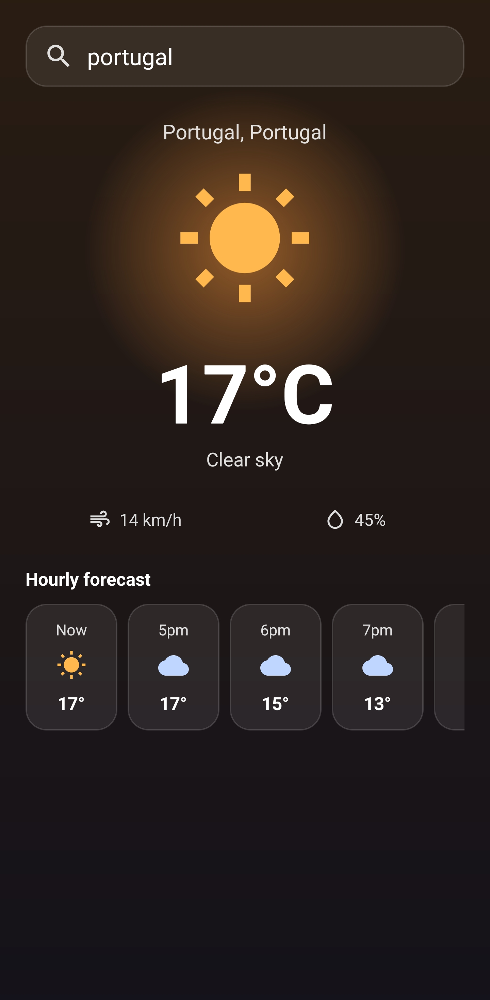
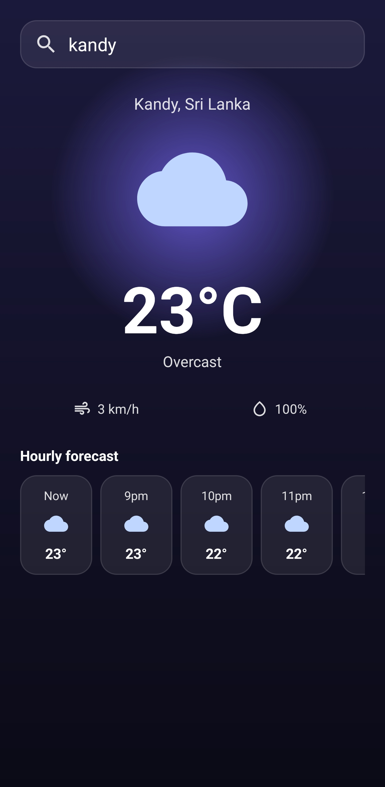
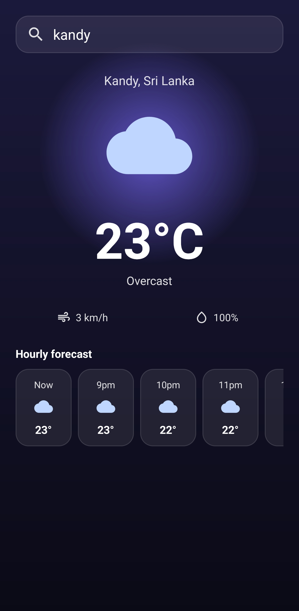
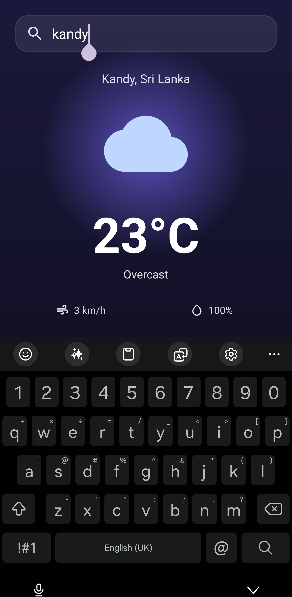
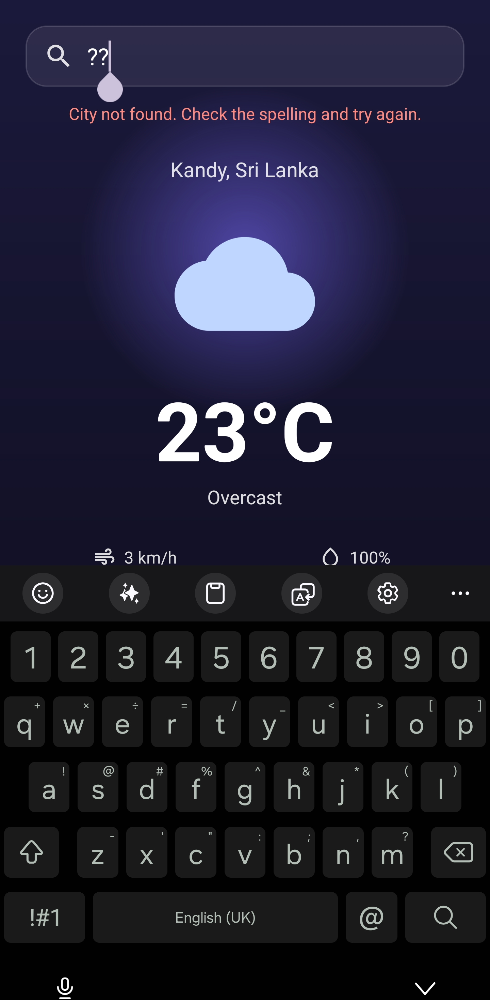
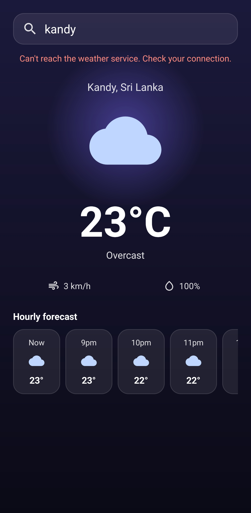

# Weather App

An Android weather app with a dark, glowing interface that changes with the conditions. Search any city to see its live temperature, humidity, wind speed, weather description and an hourly forecast.

Built as **Task 3** of the Auspify Technologies Android Developer Internship.

## Features

- Search any city by name
- Real-time temperature, humidity, wind speed and conditions
- Hourly forecast for the next 8 hours, shown in the city's local time
- Background, glow color and icon change with the weather (sunny, rain, night)
- Smooth animations: staggered entrance, pulsing glow, floating icon, animated temperature count-up and a crossfade between moods
- Loading state with a spinner while data is fetched
- Clear error messages for an unknown city and for no internet connection
- Keeps the searched city after screen rotation

## Tech Stack

- Kotlin
- Android Studio, XML layouts, View Binding
- Retrofit and Gson for REST calls and JSON parsing
- Kotlin Coroutines (`lifecycleScope`)
- RecyclerView with ListAdapter and DiffUtil
- Property animations (`ObjectAnimator`, `ValueAnimator`, `TransitionDrawable`)
- [Open-Meteo](https://open-meteo.com/) weather and geocoding APIs

## Screenshots

| Sunny | Night | Hourly forecast |
|---|---|---|
|  |  |  |

| Search | City not found | No internet |
|---|---|---|
|  |  |  |

## How to Run

1. Clone the repository
2. Open it in Android Studio
3. Let Gradle sync
4. Run on an emulator or a device with Android 10 (API 29) or higher

No API key is needed, but the device must be online.

## Data Source

Weather data is provided by [Open-Meteo](https://open-meteo.com/) under the CC BY 4.0 license.

## Author

Ameer, Auspify Android Developer Intern